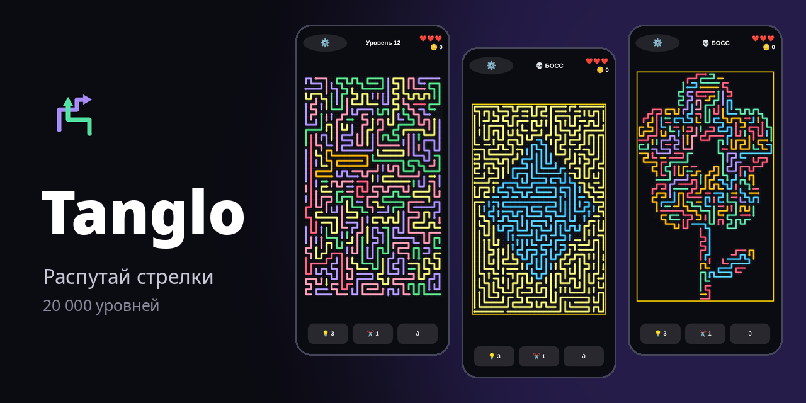
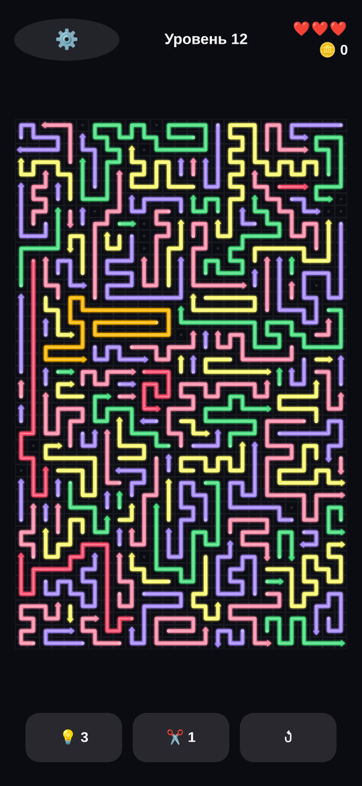
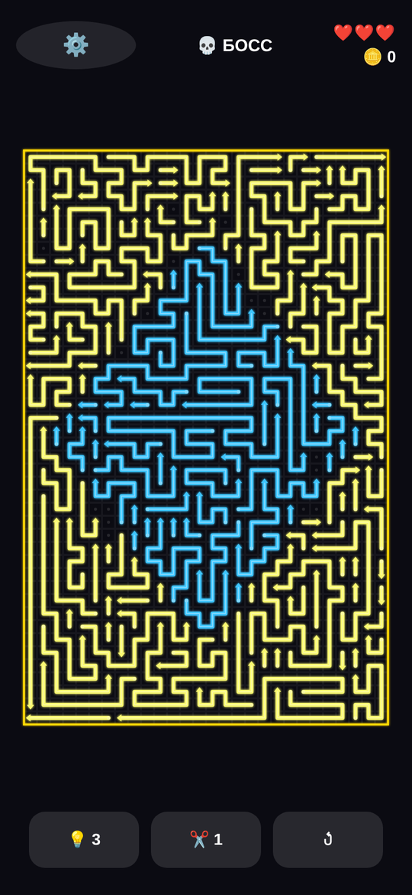
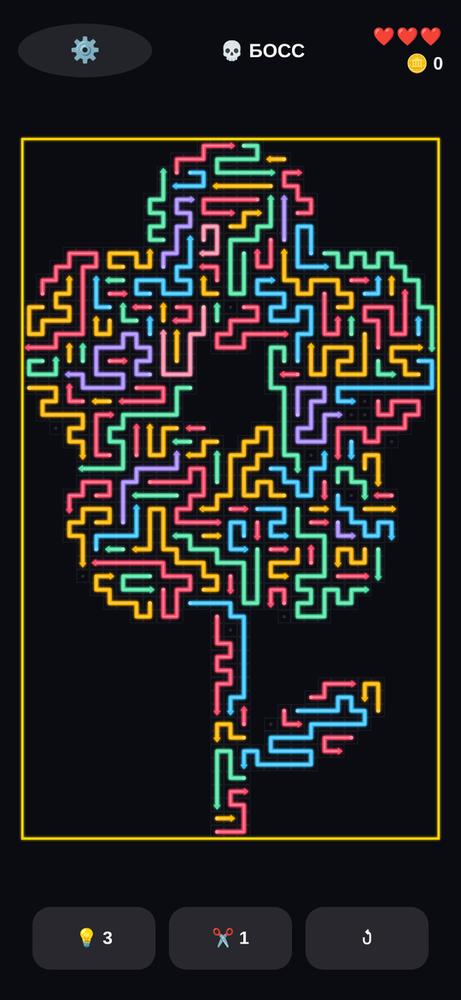

# Tanglo — распутай стрелки



Головоломка: поле плотно заполнено стрелками. Нажми на стрелку — она уезжает туда, куда смотрит,
если на её пути до края поля нет других стрелок. Нужно убрать все. Ошибся три раза — уровень проигран.

- Готовые уровни, одинаковые у всех игроков; сложность растёт от уровня к уровню. В репозитории — первая тысяча, полный набор из 20 000 собирается генератором.
- Каждый 10-й уровень — картинка: поле в форме фигуры, фигура, выделенная цветом, или контур из длинных стрелок.
- Зум щипком и прокрутка — большие поля (до 32×52) удобно разбирать на телефоне.
- Подсказки и ножницы, звёзды и монеты, две темы оформления.
- Музыка, звуки, эффекты и вибрация отключаются по отдельности.
- Чистый HTML/CSS/JS без зависимостей и сборки; звук синтезируется в браузере, аудиофайлов нет.

| | | |
|---|---|---|
|  |  |  |

## Запуск

Игра — статическая страница. Откройте `index.html` в браузере или поднимите любой статический сервер:

```sh
python3 -m http.server 8000   # → http://localhost:8000
```

Для GitHub Pages достаточно включить Pages для ветки `main` (корень репозитория).

Параметры для отладки: `index.html?debug=1&level=150` — сразу открыть уровень.

## Android

`android/` — тонкая обёртка: полноэкранный WebView, игра лежит в assets.

```sh
bash android/build-apk.sh        # → android/Tanglo-debug.apk
```

Скрипт собирает офлайн и ожидает готовый тулчейн (JDK 17, Gradle 8.7, архивы Android SDK 34, кеш AGP 8.5.1)
в каталоге из переменной `TOOLCHAIN` — см. комментарии в начале скрипта. С обычной установкой Android Studio
проект собирается как любой Gradle-проект: `gradle -p android assembleDebug` (перед этим скопируйте
`index.html`, `style.css`, `src/`, `levels/` в `android/app/src/main/assets/www/`).

Это отладочная сборка. Для Google Play нужны подписанный release-бандл и актуальный `targetSdk`.

## Уровни

Уровни сгенерированы заранее (паки по 100 уровней). Игра подгружает нужный пак по мере прохождения
(`src/levelpacks.js`), первый уровень — обучающий. В репозитории в `levels/` лежит первая тысяча;
за её пределами игра переходит на встроенный процедурный генератор. Полный набор собирается командами ниже
в `levels-full/` (в git не входит) — Android-сборка берёт его, если он есть.

Генератор живёт в [`core/`](core/README.md): обратное построение (уровень решаем по построению),
поля потока, полировка под целевые метрики сложности, ~25 силуэтов для уровней-картинок.

```sh
cd core
npm run build                 # сгенерировать 1…20000 (≈2,5 ч на 12 ядрах; прерванная сборка продолжается)
npm run check                 # проверить каждый уровень кодом игры
node tools/export.js          # перенести паки в ../levels-full для игры и APK
npm run view                  # просмотрщик уровней в браузере
```

## Структура

```
index.html, style.css   страница игры
src/                    код игры (модель, рендер, ввод, звук, интерфейс)
levels/                 готовые уровни (первая тысяча)
core/                   генератор уровней и инструменты
android/                Android-обёртка
tools/test.js           тесты игры: node tools/test.js
docs/                   обложка, скриншоты, графика для магазина
```

## Тесты

```sh
node tools/test.js            # модель, решатель, ввод, зум
node core/tools/check.js core/levels   # все уровни через валидатор игры
```
